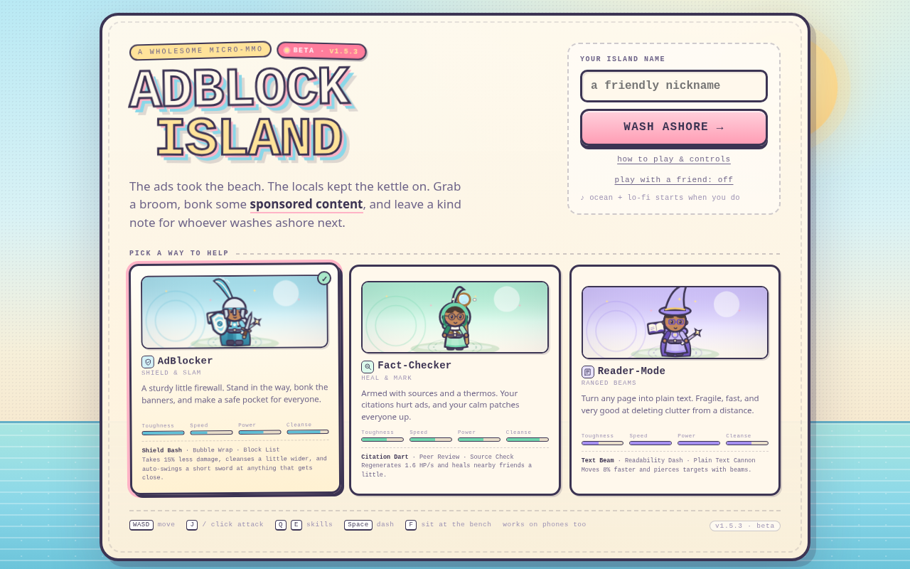
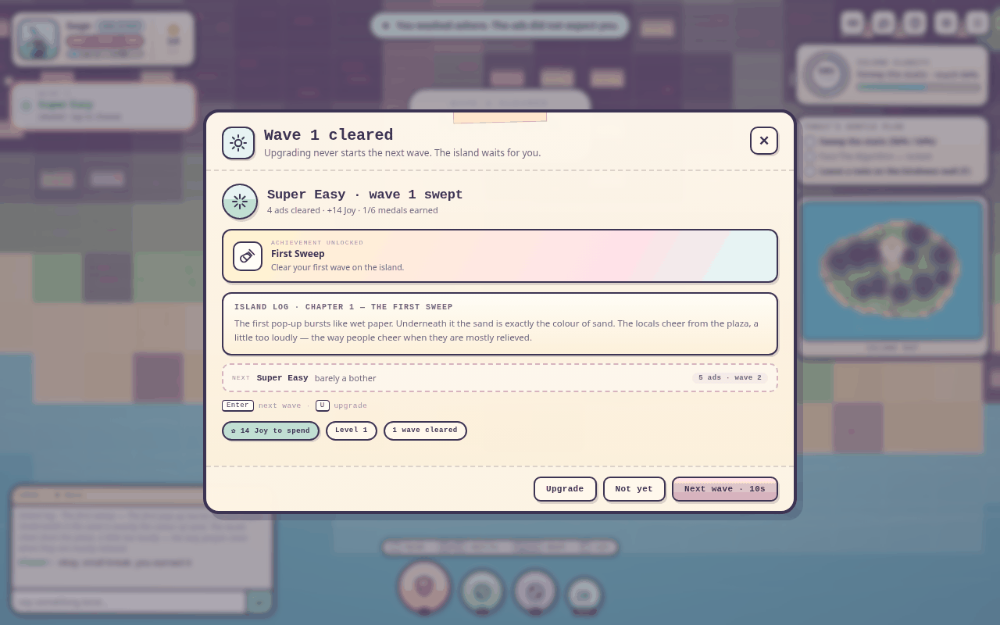
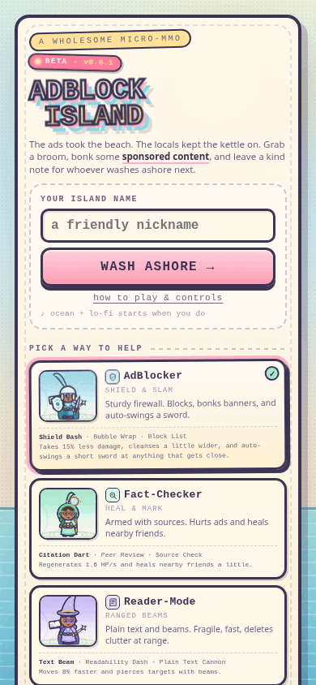

# AdBlock Island

**v0.6.1 · beta** · [Play it](https://potaterrr.github.io/adblock-island/) · [Patch notes](CHANGELOG.md)

A wholesome micro-MMO in a single HTML file, currently in **beta**. The ads took the beach, the locals kept the kettle on. Pick a class, sweep the static, bonk the ad-monsters, and leave a kind note for whoever washes ashore next.

Everything is self-contained: no build step, no CDN, no images, no fonts, no backend, no accounts, no trackers. The island is drawn with the Canvas 2D API, and the ocean, lo-fi chords, and sound effects are synthesized with the Web Audio API.

```
index.html   ← the entire game (≈370 KB, markup + CSS + renderer + audio + logic)
```

## Status: beta

**v0.6.1 is a beta.** The island is playable end to end — three classes, two companions, the wave ladder, medals, items, the Algorithm, kindness notes and same-keyboard co-op — but it is not a finished MMORPG.

Versions count from zero while the game is in beta, so every release is `0.x`; the title card's build tag and the top entry of the patch notes always agree.

Storage keys: `adblock-island.save.v0`, `adblock-island.notes.v0` and `adblock-island.settings.v0`. They are schema tags rather than versions, and they live in `localStorage` only.

Still pending, in short:

- **Achievements.** Six wave medals exist. A medal gallery, unlock toasts, medals for the boss/stats/classes/co-op, and account-wide persistence do not.
- **Cool items.** Waves give seven small items that are mostly free upgrade ranks. A real inventory, cosmetic drops with an equip screen, rarity tiers and usable items are still to come.
- **MMORPG essentials.** Online multiplayer and rooms, accounts and cross-device saves, moderated chat, parties and guilds, quests and raids, trading, anti-cheat and live ops. These need a backend; a static `index.html` on GitHub Pages cannot provide them.

The full, honest list lives in **[Still pending](CHANGELOG.md#still-pending)** at the top of the patch notes.

## Screenshots

| The title screen | A wave cleared |
| --- | --- |
|  |  |

<p align="center">
  
</p>

## Backstory

The ads came with the tide.

Nobody on the island remembers the exact morning it happened. One day the shoreline was just shoreline, and the next there were pop-ups half-buried in the sand, banners strung between the palms like festival bunting, and one unskippable video ad that has been loading since before anyone can remember. It plays a little further every year.

The locals did not leave. They put the kettle on, swept what they could with brooms and umbrellas, and kept the plaza lit. They got very good at living around the clutter — stepping over it, apologising to it, naming the worst banners after people they disliked. But the static kept creeping inland, and somewhere past the treeline something big started running ad breaks on a schedule.

You wash ashore with a broom, a class, and nowhere else to be. The islanders saved you a spot by the fire and a patch of sand to clean. That is the whole job: push the static back, keep the plaza kind, and leave a note on the bench for whoever washes ashore next.

It is not a sad story. The ocean is still warm, the kettle still works, and the ads are, in the end, only made of paper.

## How to play

**1. Wash ashore.** Pick a class on the title screen — AdBlocker (shield and slam, tough), Fact-Checker (darts and healing), or Reader-Mode (piercing beams, fast and fragile) — type a name, and press **wash ashore**. Your class can be changed later from the pause menu.

**2. Move and aim.** `WASD` to walk, mouse to aim, `J` or click to attack. On a phone, the left thumb stick moves you and points your aim, and the big **BONK** button attacks. Dashes are `Space` or the dash button. Attacks snap to the ad nearest your aim line, so you never have to pixel-hunt.

**3. Clean the static.** Purple static sits on the ground across the island. Walking over it scrubs a little; hitting it with your weapon clears it much faster and pays **Joy** and **XP**. Joy is spent on permanent upgrades (`U`) — damage, health, speed, cleanse radius, and cozy cosmetics.

**4. Survive the waves.** Every run starts at **Super Easy** and climbs only when you say so. Clear a wave and the island asks what's next: **Upgrade** (the shop is safe — it never starts the next wave) or **Next wave**, which gives you a **10-second countdown** to spend Joy, take a breath, or change your mind. Each clear pays bonus Joy and XP and hands you a **medal or a free item**, plus the next chapter of the island's story. Watch the card under your portrait for the wave, the tier and what's left.

**5. Reach Super Hard.** Wave 10 is the last of the ladder: clear it and the island stops serving ads for good. There is no fail screen — the ladder simply restarts at Super Easy next visit, and after Super Hard the endless **Super Hard+** waves are there if you want to keep going.

**6. Wake the Algorithm.** When the island is about 64% clear, the boss wakes at the plaza and starts running ad breaks. Dodge the sponsored beams, break its health thresholds, and finish the fight. Waves pause while it is out.

**7. Be a neighbour.** The two heroes whose classes you did not pick are already here: they cleanse, chip ads, heal and chat, and they can be knocked out and carried back to the bench. At the cozy bench (`F`), sit down and pin a note to the kindness wall — it is saved in your browser and read by whoever visits next, including you on a bad day.

**8. Bring a friend (optional).** Choose **play with a friend** on the title screen for same-keyboard co-op: player 2 moves on the arrow keys and attacks automatically, shares Joy and waves, and is a real hero that ads will target.

There is no fail state that erases progress, no timer, and no score to chase. Play for ten minutes or an hour. Progress, notes, and settings save automatically in `localStorage`.

## Play it

Open `index.html` directly, or serve the folder:

```bash
python3 -m http.server 8000
# then visit http://localhost:8000
```

Audio starts after the first click, as browsers require.

## Controls

| Action | Keyboard / mouse | Touch |
| --- | --- | --- |
| Move | `WASD` (arrows drive player 2 in co-op) | left thumb stick |
| Aim | mouse cursor — free aim, even while walking, and device detection cannot get in the way | aims where the stick points |
| Attack | `J` or click / hold | BONK button |
| Skill one | `Q` | SKILL button |
| Skill two | `E` | SKILL button |
| Dash | `Space` | dash button |
| Sit / leave a note | `F` near the bench | sit button near the bench |
| Upgrades | `U` | pause → Upgrades |
| Chat | `C` | chat tool |
| Wave choice | `N` (when a wave is cleared) | tap the wave card |
| Next wave / upgrade | `Enter` takes the next wave, `U` opens the shop while the cleared card is open | tap the buttons in the card |
| Help | `H` | pause → How to play |
| Settings | — | pause → Settings |
| Pause | `Esc` | pause tool |
| Mute | `M` | speaker tool |

Attacks snap onto the ad closest to your aim line, so you rarely have to pixel-hunt — especially on a phone, where the stick direction is the aim. The AdBlocker's auto-sword never changes the direction you aimed: it swings in its own forward arc.

### Player 2 (same keyboard)

Turn on **play with a friend** on the title screen.

| Action | Player 2 |
| --- | --- |
| Move | arrow keys |
| Attack | automatic, at whatever they face |
| Everything else | automatic (regen, knockback, shared Joy and waves) |

The camera frames both heroes and gently leashes player 2 to within one screen of player 1. The partner is a real hero: ads target and damage them, the Fact-Checker variant marks ads, and they count for wave clears.

## Waves

Ads arrive in waves instead of trickling in at random. Each wave has a fixed crew, and the tiers climb:

| Waves | Tier | Crew |
| --- | --- | --- |
| 1–2 | Super Easy | four pop-ups, then three pop-ups and two banners |
| 3–4 | Easy | six ads a wave; the first Clickbait Mimic arrives at wave 4 |
| 5–6 | Normal | eight and nine ads, more mimics, flyers coming faster |
| 7–8 | Hard | nine and eleven ads; behemoths from wave 7, two of them at wave 8 |
| 9–10 | Super Hard | thirteen and fourteen ads, three behemoths, damage ×1.36 and ×1.45 |
| 11+ | Super Hard+ | the same shape, growing a fixed amount each wave up to twenty ads |

Every stage is a fixed recipe (`STAGE_CREWS` in the source), so the preview on the cleared-wave card always matches what actually spawns. The card under your portrait names what is left standing — `2 pop-ups · 1 behemoth` — instead of only counting it.

### Upgrade or move on

Clearing a wave never rolls straight into the next one. The island stops and asks, with a card showing the wave you just cleared, the chapter of the island log you unlocked, the reward you earned, and a preview of what's coming:

- **Upgrade** opens the shop. Buying things never starts the next wave — you can sit there as long as you like.
- **Next wave** starts a **10-second countdown** (shown on the card under your portrait). Open the shop during it and the countdown politely pauses until you close it. Press `N` or tap the wave card to reopen the choice if you closed it.

**Every clear hands you something.** Milestone waves give a medal; the rest give a free item — a spare broom, a wool blanket, a jar of joy, a kettle break — which is a free upgrade rank, a heal, or Joy.

| Medal | Earned at |
| --- | --- |
| First Sweep | clear wave 1 |
| Polite Static | reach Easy (wave 3) |
| They Brought Friends | reach Normal (wave 5) |
| Banner Bane | reach Hard (wave 7) |
| Hold the Line | reach Super Hard (wave 9) |
| Island Saved | clear Super Hard (wave 10) |

Medals and found items live in the pause screen (`Esc`), and carry over between visits.

### The end of the ladder

Wave 10 is **Super Hard**. Clear it and the island tells you plainly: *you saved this island from serving ads*. The kettle is on, the plaza is quiet, and the story reaches its last chapter. Keep going if you like — waves 11+ are endless **Super Hard+**, with a few extra island-log entries, and the next visit starts back at Super Easy whenever you want to climb again.

The Algorithm still interrupts the schedule when the island is clear enough to wake it; waves pause until that fight is over. The wave banner announces each new tier, the card under your portrait tracks the wave, its difficulty and what's left, and your companions comment in chat.

## Classes

| Class | Role | Weapon & look | Signature |
| --- | --- | --- | --- |
| **AdBlocker** | shield & slam | plumed helm, kite shield, arming sword | Wide shield bash; auto-swings the sword at anything within arm's reach; takes 15% less damage. |
| **Fact-Checker** | heal & mark | hood, magnifier staff, satchel | Citation darts mark ads and heal nearby companions; regenerates 1.6 HP/s. |
| **Reader-Mode** | ranged beams | wizard hat, floating tome, quill wand | Piercing text beams hit every ad in a row; 8% faster, a little fragile. |

Each class has its own power multiplier on every hit: AdBlocker 1.00, Fact-Checker 0.92, Reader-Mode 1.16.

Gear picks up gold trim from level 3 and a soft glow from level 6. Every hero and local rolls their own skin, hair, and level.

## Your companions

The island is you plus the two heroes who picked the other classes. They roam, cleanse static, chip ads, and chat in the local log — and the Fact-Checker among them heals you 8 HP on a cooldown. They are support, not a solution: their damage is a fraction of yours, their chip damage on the Algorithm is capped at two helpers, and a kill is the party's kill so nobody steals your reward.

They can be knocked out. A downed companion sits out 14 seconds and walks back from the bench at 60% health, and the HUD chips show the timer. Keep them standing and they keep the plaza lit.

## What is on the island

- **Wave combat:** escalating crews from Super Easy to Super Hard+, with on-screen wave banners and a HUD tracker.
- **Four ad-monsters plus a boss:** Pop-Up Imps spawn clickable `[X]` windows, Unskippable Behemoths are invulnerable until their SKIP window, Clickbait Mimics hide as free Joy, and Banner Bats throw flyers. The Algorithm runs ad breaks, sponsored beam attacks, and summons more content at health thresholds.
- **Joy and clarity:** every fully cleansed tile pays Joy and experience. Spend Joy on permanent upgrades or cozy cosmetics.
- **Same-keyboard co-op:** a second hero on the arrow keys, sharing one screen and one wave.
- **A party of three:** the two heroes whose classes you did not pick fight beside you, cleanse, heal, chat, and can be knocked out and revive at the bench.
- **The kindness wall:** sit at the cozy bench and pin a note for the next person. Notes are saved locally and read by the locals.
- **Procedural sound:** generated ocean noise, a slow lo-fi chord progression, UI sounds, combat hits, cleansing sparkles, and a boss track that shifts when the fight starts.
- **Retro-pastel UI:** responsive HUD, minimap, floating damage numbers, speech bubbles, screen shake, particles, scanlines (toggleable), and a reduced-motion option.
- **Persistence:** progress, notes, settings, and cosmetics live in `localStorage`.

## Deploying to GitHub Pages

There is no build step. Any static host will do.

1. Put `index.html` (and `.nojekyll`) at the root of a repository.
2. Open **Settings → Pages**.
3. Under **Build and deployment**, choose **Deploy from a branch**.
4. Select your branch and `/ (root)`, then save.

The game lands at `https://<username>.github.io/<repo>/`. It also works from a subfolder — the file uses relative paths only.

If you use Jekyll and want the file served untouched, keep the empty `.nojekyll` file at the root of the deployed branch.

## Save data

The game stores three keys in `localStorage`:

- `adblock-island.save.v0` — name, class, level, Joy, upgrades, cosmetics, stats, boss progress, corruption map
- `adblock-island.notes.v0` — the local kindness wall
- `adblock-island.settings.v0` — volume, mute, scanlines, particles, numbers, reduced motion

Clearing site data resets the island. Nothing is sent anywhere.

## Project layout

```
adblock-island/
├── index.html     # the whole game: markup, styles, canvas renderer, audio, logic
├── CHANGELOG.md   # version history and patch notes
├── README.md
└── .nojekyll      # keep GitHub Pages from running Jekyll
```

## Performance notes

The renderer targets 60 fps on phones and a calm 30–60 fps on desktop. It is a single canvas with a y-sorted scene, a cached minimap, and throttled floating text. If a machine struggles, the settings panel can turn off particles, screen shake, scanlines, and damage numbers.

On a touch screen the HUD is deliberately thinner than the desktop one: a compact top bar with a level chip instead of an XP bar, a two-line wave card whose second line carries the crew, a clarity ring with no caption, and mute, chat and pause as the only tool buttons (help and settings live in the pause panel). Wave banners shrink to a short pill, the toast tray keeps two messages, and no more than two pop-up windows are open at once. Using a mouse brings the full desktop layout back instantly.

## Patch notes

The full history lives in **[CHANGELOG.md](CHANGELOG.md)**, newest first, and the version on the title card always matches its top entry. The two most recent releases are the ones worth reading if you have played before: **0.6.0** is the balance pass — the two heroes whose classes you did not pick became your party, the ladder became a table of fixed crews, and class power finally applies to every hit — and **0.6.1** is the phone HUD diet, which folds the top of the screen into one quiet bar.

| Version | Date | Headline |
| --- | --- | --- |
| [0.6.1](CHANGELOG.md#061--2026-10-30) | 2026-10-30 | Quieter phone HUD: one top bar, three tool buttons, calmer banners, toasts and pop-ups |
| [0.6.0](CHANGELOG.md#060--2026-10-30) | 2026-10-30 | Balance pass: two companions replace the locals, harder stage ladder, live class power |
| [0.5.4](CHANGELOG.md#054--2026-10-29) | 2026-10-29 | Beta launch polish: social card, richer previews, screenshots |
| [0.5.3](CHANGELOG.md#053--2026-10-29) | 2026-10-29 | Enter takes the next wave; U opens upgrades from the cleared card |
| [0.5.2](CHANGELOG.md#052--2026-10-29) | 2026-10-29 | Waves keep running after the island victory; clear popup can no longer be lost |
| [0.5.1](CHANGELOG.md#051--2026-10-29) | 2026-10-29 | Beta label and version on the splash screen; "Still pending" notes |
| [0.5.0](CHANGELOG.md#050--2026-10-29) | 2026-10-29 | Upgrade-or-next-wave choice, 10s countdown, medals, items, story chapters |
| [0.4.3](CHANGELOG.md#043--2026-10-29) | 2026-10-29 | Backstory and credits in the help panel, documented README |
| [0.4.2](CHANGELOG.md#042--2026-10-29) | 2026-10-29 | Compact phone class picker; all three classes on one screen |
| [0.4.1](CHANGELOG.md#041--2026-10-29) | 2026-10-29 | Touch controls and HUD scaled to fit phones |
| [0.4.0](CHANGELOG.md#040--2026-10-29) | 2026-10-29 | Escalating waves, wave HUD, same-keyboard co-op |
| [0.3.2](CHANGELOG.md#032--2026-10-29) | 2026-10-29 | Aim follows the player; chibi hero renderer |
| [0.3.1](CHANGELOG.md#031--2026-10-29) | 2026-10-29 | Kindness wall and bench sitting |
| [0.3.0](CHANGELOG.md#030--2026-10-29) | 2026-10-29 | The Algorithm boss fight |
| [0.2.0](CHANGELOG.md#020--2026-10-29) | 2026-10-29 | Upgrade shop, cosmetics, save data |
| [0.1.0](CHANGELOG.md#010--2026-10-29) | 2026-10-29 | Procedural audio, settings, accessibility toggles |
| [0.0.0](CHANGELOG.md#000--2026-10-29) | 2026-10-29 | First build: the island, three classes, static cleansing |

## Disclaimer

AdBlock Island is **my own original work** — written, drawn, composed and play-tested by me, [@potaterrr](https://github.com/potaterrr), as a solo project. Every part of it is hand-written: the Canvas 2D renderer, the character art (drawn procedurally in code, no image files), the Web Audio soundtrack and sound effects, the UI, and the writing.

- **No third-party assets.** No images, sprites, fonts, audio files, libraries, frameworks, CDNs or tracking scripts are used. The single `index.html` is the whole thing.
- **No affiliation.** It is a work of parody and a small non-commercial joke about ad fatigue. It is not affiliated with, endorsed by, or connected to any ad blocker, browser, advertiser, or platform. All ads, brands, and characters in it are fictional.
- **No data collection.** Nothing is uploaded. Progress, notes, and settings are stored only in your browser's `localStorage` and clearing site data removes them.
- **Licence.** The source is public so it can be read and learned from; please don't republish it as your own. If you want to reuse a piece of it, ask first.

© 2026 potaterrr. Thanks for washing ashore.
