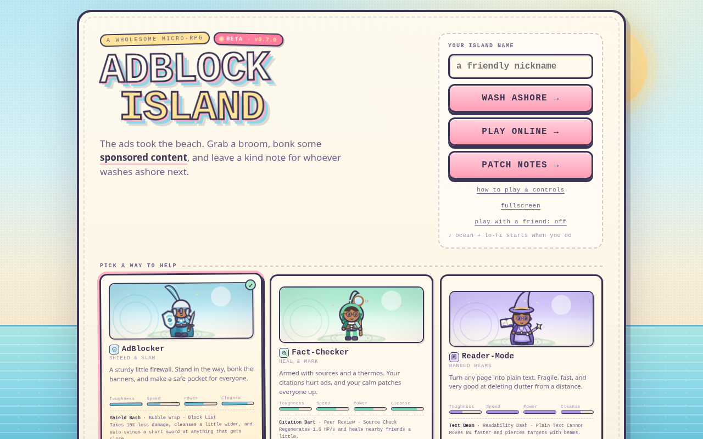
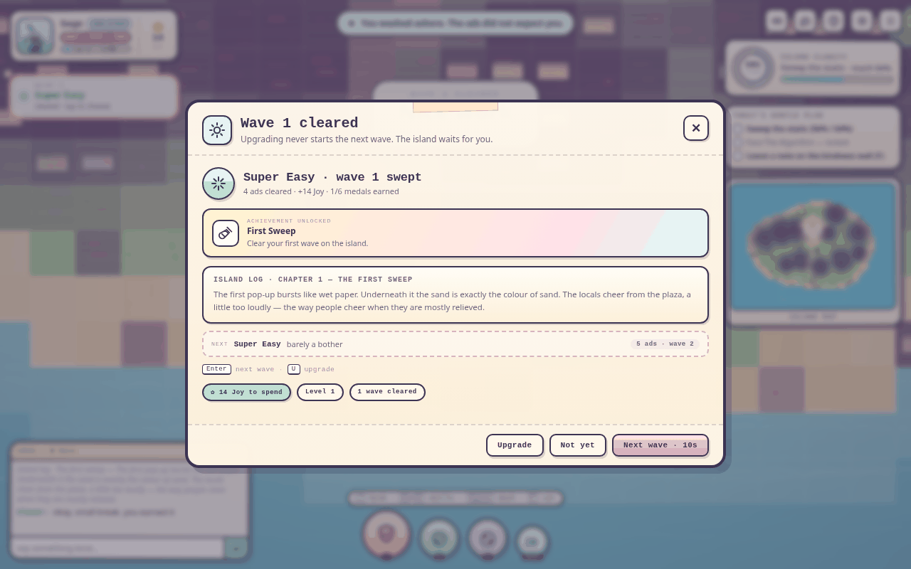
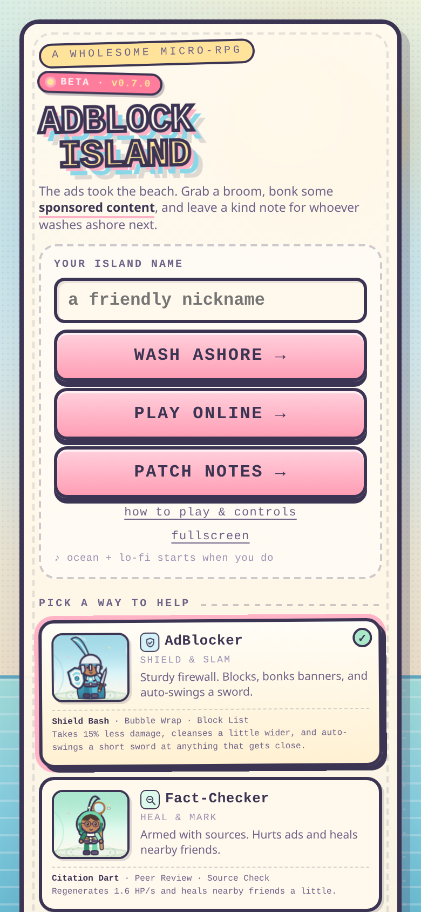

# AdBlock Island

**v0.1.0 · Online beta, back to normal** · [Play it](https://potaterrr.github.io/adblock-island/) · [Patch notes](https://potaterrr.github.io/projects/adblock-island/#patch-notes)

A wholesome micro-RPG in a single HTML file, currently in **beta**. The ads took the beach, the locals kept the kettle on. Pick a class, sweep the static, bonk the ad-monsters, and leave a kind note for whoever washes ashore next.

Everything is self-contained: no build step, no CDN, no images, no fonts, no backend, no accounts, no trackers. The island is drawn with the Canvas 2D API, and the ocean, lo-fi chords, and sound effects are synthesized with the Web Audio API.

```
index.html   ← the entire game (≈420 KB, markup + CSS + renderer + audio + logic)
```

## Status: beta

**v0.1.0 is a beta**, and it is the first release on the **online-beta** branch. The island is playable end to end — nine classes, two companions, the wave ladder, Endless mode with checkpoints, medals, items, the Algorithm, the south-shore dock, kindness notes and same-keyboard co-op. The Halloween theme and Four-boss Mania mode are gone, the theme is back to the plain island palette, and the Algorithm wakes on a **33%** roll per eligible wave and splits once into two. This branch restarts the version count at **0.1.0** for the networked era; its patch notes are separate from the main branch, but the game is still one page, one file.

Versions count from zero while the game is in beta, so every release is `0.x`; the title card's build tag and the top entry of the patch notes always agree.

Storage keys: `adblock-island.save.v0`, `adblock-island.notes.v0` and `adblock-island.settings.v0`. They are schema tags rather than versions, and they live in `localStorage` only.

Still pending, in short:

- **Achievements.** Medals now cover waves, each class, co-op, the Algorithm boss, spending, cleanup and Endless milestones, with a gallery and unlock toasts in the pause screen. Dated unlock history and account-wide persistence are still to come.
- **Cool items.** Waves give seven small items that are mostly free upgrade ranks. A real inventory, cosmetic drops with an equip screen, rarity tiers and usable items are still to come.
- **Online co-op essentials.** Networked rooms, accounts and cross-device saves, moderated chat, parties and quests, trading and anti-cheat. These need a backend, so the online build lives on this branch: Vercel hosts the game and a tiny signaling API, a free Redis store holds room codes and WebRTC handshakes, and one player hosts the authoritative simulation. Room-code co-op is the next milestone, not shipped in v0.1.0.

The full, honest list lives in **[Still pending](CHANGELOG.md#still-pending)** at the top of the patch notes.

## What's new in v0.1.0 — Online beta, back to normal

A short version of the [patch notes](CHANGELOG.md):

- **Back to the plain island.** The Halloween theme is removed entirely: no theme toggle, no `HALLOWEEN` badge, no pumpkin moon, fog, bats or jack-o'-lanterns. The default palette, title sky and decorations are the ordinary island again.
- **Mania is out.** The `MANIA` badge, rules note and Settings → Four-boss Mania toggle are gone.
- **Bosses stop at two.** At 75% HP a boss still splits once into two smaller halves, but children never split again. Two live bosses move and attack 25% faster.
- **One boss, 33% per wave.** Once the island is 64% clear, each wave has a **33%** chance to wake the Algorithm; a failed roll tries again next wave.
- **Normal death.** Death no longer wipes the run: you wake at the bench with full health. In Endless during a fight, the current wave restarts and your Joy and upgrades are kept.
- **Co-op scaling.** Extra humans add ads (up to +6, hard-capped at 22 in a wave) and **+55% monster health** each; the Algorithm scales **+55%** per extra hero, so solo runs keep the tuned numbers.
- **micro-RPG, not MMO.** Wording across the page, help panel and docs now calls it a co-op RPG.
- **Version reset.** This branch restarts at **v0.1.0** with its own patch notes; the game is still one page and one file.

## Download

**[Download v0.1.0](https://github.com/potaterrr/adblock-island/releases/tag/v0.1.0)** (`adblock-island-beta-v0.1.0.zip`, also at the repo root). It is rebuilt from `index.html`, `README.md` and `CHANGELOG.md`. Unzip it, open `index.html`, and it plays — online or offline.

One honest caveat: **co-op is still local in v0.1.0.** "Play with a friend" puts player two on the same keyboard (arrow keys) on the same screen. The online-beta branch is where room-code networking lands: Vercel static hosting plus a tiny signaling API, host-authoritative WebRTC, and the same single page. Until that ships, the zip stays a complete single-player/same-keyboard-co-op game.

## Screenshots

| The title screen | A wave cleared |
| --- | --- |
|  |  |

<p align="center">
  
</p>

## Backstory

The ads came with the tide.

Nobody on the island remembers the exact morning it happened. One day the shoreline was just shoreline, and the next there were pop-ups half-buried in the sand, banners strung between the palms like festival bunting, and one unskippable video ad that has been loading since before anyone can remember. It plays a little further every year.

The locals did not leave. They put the kettle on, swept what they could with brooms and umbrellas, and kept the plaza lit. They got very good at living around the clutter — stepping over it, apologising to it, naming the worst banners after people they disliked. But the static kept creeping inland, and somewhere past the treeline something big started running ad breaks on a schedule.

You wash ashore with a broom, a class, and nowhere else to be. The islanders saved you a spot by the fire and a patch of sand to clean. That is the whole job: push the static back, keep the plaza kind, and leave a note on the bench for whoever washes ashore next.

It is not a sad story. The ocean is still warm, the kettle still works, and the ads are, in the end, only made of paper.

## How to play

**1. Wash ashore.** Pick a class on the title screen — AdBlocker (shield and slam, tough), Fact-Checker (darts and healing), Reader-Mode (piercing beams, fast and fragile), Engineer (turrets and overclock), Medic (heals and shields), Hacker (exploits and marks), Streamer (wide hype bursts), Archivist (marks and party support), or Moderator (stuns and knockback) — type a name, and press **wash ashore**. Your class can be changed later from the pause menu.

**2. Move and aim.** `WASD` to walk, mouse to aim, `J` or click to attack. On a phone, the left thumb stick moves you and points your aim, and the big **BONK** button attacks. Dashes are `Space` or the dash button. Attacks snap to the ad nearest your aim line, so you never have to pixel-hunt.

**3. Clean the static.** Purple static sits on the ground across the island. Walking over it scrubs a little; hitting it with your weapon clears it much faster and pays **Joy** and **XP**. Joy is spent on upgrades (`U`) — damage, health, speed, cleanse radius, and cozy cosmetics.

**4. Survive the waves.** Every run starts at **Super Easy** and climbs only when you say so. Clear a wave and choose **Upgrade** or **Next wave**; the next wave is always available. **Leaving the upgrade shop after a clear starts the next-wave countdown automatically**, so browse and buy before you close it. **Next wave** gives you a **10-second countdown** to take a breath or change your mind. Each clear pays bonus Joy and XP and hands you a **medal or a free item**, plus the next chapter of the island's story. Watch the card under your portrait for the wave, the tier, what's left, and (in Endless) the enemy damage pressure.

**5. Reach Super Hard, then Endless.** Wave 10 is the last of the campaign ladder: clear it and the island stops serving ads for good. If you want more, wave 11 opens **Endless mode**: no final wave, enemy damage climbs with depth, and every third wave is a **checkpoint** that pauses the island, pays you Joy (80, 100, 120…), and offers an optional upgrade. Continue is always available.

**6. Wake the Algorithm.** When the island is about 64% clear, the boss wakes at the plaza and starts running ad breaks. Dodge the sponsored beams, break its health thresholds, and finish the fight. There is exactly **one boss per run**. Once the island is **64% clear**, each wave has a **33%** chance to wake it; a failed roll tries again on the next wave. At **75% health** a boss is consumed and splits into **two smaller bosses**, and those halves cannot split again. Two live bosses move and attack **25% faster**. Beams and summons are randomised. Waves pause while bosses are out.

**7. Be a neighbour.** Two companions are already here: they cleanse, chip ads, mark or stun, and chat, and they can be knocked out and carried back to the bench. They never heal the real player — the healer kits belong to the player alone. At the cozy bench (`F`), sit down and pin a note to the kindness wall — it is saved in your browser and read by whoever visits next, including you on a bad day.

**8. Bring a friend (optional).** Choose **play with a friend** on the title screen for same-keyboard co-op: player 2 moves on the arrow keys and attacks automatically, shares Joy and waves, and is a real hero that ads will target.

There is no timer and no score to chase. Play for ten minutes or an hour. Run progress resets each visit; medals, notes, settings and lifetime bests save automatically in `localStorage`.

## Play it

Open `index.html` directly, or serve the folder:

```bash
python3 -m http.server 8000
# then visit http://localhost:8000
```

Audio starts after the first click, as browsers require.

## Controls

| Action | Keyboard / mouse | Touch |
| --- | --- | --- |
| Move | `WASD` (arrows drive player 2 in co-op) | left thumb stick |
| Aim | mouse cursor — free aim, even while walking, and device detection cannot get in the way | aims where the stick points |
| Attack | `J` or click / hold | BONK button |
| Skill one | `Q` | SKILL button |
| Skill two | `E` | SKILL button |
| Dash | `Space` | dash button |
| Sit / leave a note | `F` near the bench | sit button near the bench |
| Upgrades | `U` | pause → Upgrades |
| Chat | `C` | chat tool |
| Wave choice | `N` (when a wave is cleared) | tap the wave card |
| Next wave / upgrade | `Enter` takes the next wave, `U` opens the shop while the cleared card is open | tap the buttons in the card |
| Help | `H` | pause → How to play |
| Settings | — | pause → Settings |
| Pause | `Esc` | pause tool |
| Mute | `M` | speaker tool |

Attacks snap onto the ad closest to your aim line, so you rarely have to pixel-hunt — especially on a phone, where the stick direction is the aim. The AdBlocker's auto-sword never changes the direction you aimed: it swings in its own forward arc.

### Player 2 (same keyboard)

Turn on **play with a friend** on the title screen.

| Action | Player 2 |
| --- | --- |
| Move | arrow keys |
| Attack | automatic, at whatever they face |
| Everything else | automatic (regen, knockback, shared Joy and waves) |

The camera frames both heroes and gently leashes player 2 to within one screen of player 1. The partner is a real hero: ads target and damage them, the Fact-Checker variant marks ads, and they count for wave clears.

## Waves

Ads arrive in waves instead of trickling in at random. Each wave has a fixed crew, and the tiers climb:

| Waves | Tier | Crew |
| --- | --- | --- |
| 1–2 | Super Easy | four pop-ups, then three pop-ups and two banners |
| 3–4 | Easy | six ads a wave; the first Clickbait Mimic arrives at wave 4 |
| 5–6 | Normal | eight and nine ads, more mimics, flyers coming faster |
| 7–8 | Hard | nine and eleven ads; behemoths from wave 7, two of them at wave 8 |
| 9–10 | Super Hard | thirteen and fourteen ads, three behemoths, damage ×1.36 and ×1.45 |
| 11+ | Endless | the same shape, growing a fixed amount each wave up to twenty ads, with enemy damage pressure rising every wave |

Every stage is a fixed recipe (`STAGE_CREWS` in the source), so the preview on the cleared-wave card always matches what actually spawns. The card under your portrait names what is left standing — `2 pop-ups · 1 behemoth` — instead of only counting it.

### Upgrade or move on

Clearing a wave never rolls straight into the next one. The island stops and asks, with a card showing the wave you just cleared, the chapter of the island log you unlocked, the reward you earned, and a preview of what's coming:

- **Upgrade** opens the shop. Buying things never starts the next wave while the panel is open; **closing the shop starts the normal 10-second countdown**.
- **The next wave is always available.** Upgrading is optional; the card never replaces **Next wave** with a purchase requirement. Open the shop if you want, then close it to go, or start the countdown immediately.
- **Next wave** starts a **10-second countdown** (shown on the card under your portrait). Open the shop during it and the countdown politely pauses until you close it. Press `N` or tap the wave card to reopen the choice if you closed it.

**Every clear hands you something.** Milestone waves give a medal; the rest give a free item — a spare broom, a wool blanket, a jar of joy, a kettle break — which is a free upgrade rank, a heal, or Joy.

| Medal | Earned at |
| --- | --- |
| First Sweep | clear wave 1 |
| Polite Static | reach Easy (wave 3) |
| They Brought Friends | reach Normal (wave 5) |
| Banner Bane | reach Hard (wave 7) |
| Hold the Line | reach Super Hard (wave 9) |
| Island Saved | clear Super Hard (wave 10) |

Medals and found items live in the pause screen (`Esc`), and carry over between visits. Joy, upgrades, level and island progress reset every run.

### The end of the ladder

Wave 10 is **Super Hard**. Clear it and the island tells you plainly: *you saved this island from serving ads*. The kettle is on, the plaza is quiet, and the story reaches its last chapter. Stay for the sunset, or step into **Endless mode**.

### Endless mode

Wave 11 begins **Endless**. The ads come back, and they hit harder every wave: enemy damage gains a pressure multiplier that starts at ×1.5 on wave 11, reaches ×2.4 by wave 20, and caps at ×2.6 after that. A hero who never buys **Deep Breaths** will not last; the same wave is survivable with vitality ranks and a little care.

Every third endless wave — 11, 14, 17, 20… — is a **checkpoint**:

- The island pauses and pays a checkpoint bundle: **80, 100, 120… Joy** (`60 + 20 × checkpoint`).
- The upgrade shop opens. Buying is optional; **Continue** is always enabled.
- Press `U` to shop, then **Continue** to start the next wave. **Step away** lets you leave the checkpoint and wander; the wave card brings the checkpoint back.

Dying anywhere sets you back on your feet at the bench with full health. In Endless, dying during a fight restarts the current wave instead and keeps your Joy and upgrades. Your deepest wave is still saved on the pause screen.

Endless medals: **Beyond the Ladder** (enter Endless), **Tea Break** (first checkpoint), **Deep Static** (wave 20), **Kettle On** (five checkpoints), **Ad Infinitum** (wave 30).

The Algorithm still interrupts the schedule when the island is clear enough to wake it; waves pause until that fight is over. The wave banner announces each new tier, the card under your portrait tracks the wave, its difficulty and what's left, and your companions comment in chat.

## Classes

| Class | Role | Weapon & look | Signature |
| --- | --- | --- | --- |
| **AdBlocker** | shield & slam | plumed helm, kite shield, arming sword | Wide shield bash; auto-swings the sword at anything within arm's reach; takes 15% less damage. |
| **Fact-Checker** | heal & mark | hood, magnifier staff, satchel | Citation darts mark ads and heal nearby companions; regenerates 1.6 HP/s. |
| **Reader-Mode** | ranged beams | wizard hat, floating tome, quill wand | Piercing text beams hit every ad in a row; 8% faster, a little fragile. |
| **Engineer** | turrets & overclock | hard hat, wrench, tool belt | Throws heavy wrench bolts, drops auto-firing turrets, and overclocks for a burst of speed and damage. |
| **Medic** | heal & support | cross cap, syringe staff, tabard | Syringe darts patch you on impact, First Aid heals the plaza, and Code Blue adds a shield. Regenerates 2.2 HP/s. |
| **Hacker** | debuff & exploit | hood, visor, handheld terminal | Exploit bolts pierce and mark ads for extra damage; Lag Switch and Zero-Day hit and mark crowds. |
| **Streamer** | AoE hype | headset, mic boom, stage vest | Hype shards pierce crowds, Hype Train dashes through a cone, and Raid bursts everything around you. |
| **Archivist** | support & mark | flat cap, spectacles, stamp staff, apron | Index Darts mark and pierce; Cross-Reference marks and stuns a cone; Public Record heals, shields, marks a ring and cleanses. |
| **Moderator** | crowd control | visor, headset, gavel, dark vest | Ban Hammer knocks and stuns; Lock Thread roots a crowd; Mass Ban is a wide knockback/stun/damage shockwave. Takes 10% less damage. |

Each class has its own power multiplier on every hit: AdBlocker 1.00, Fact-Checker 0.92, Reader-Mode 1.16, Engineer 1.05, Medic 0.85, Hacker 0.90, Streamer 1.20, Archivist 0.90, Moderator 0.95.

Gear picks up gold trim from level 3 and a soft glow from level 6. Every hero and local rolls their own skin, hair, and level.

## Your companions

The island is you plus two companions drawn from **AdBlocker, Reader-Mode, Archivist and Moderator**. They roam, cleanse static, chip ads, mark or stun, and chat in the local log. They are support, not a solution: their damage is exactly **10% of yours**, their chip damage on the Algorithm is capped at two helpers, and a kill is the party's kill so nobody steals your reward.

There is no AI healer. Fact-Checker and Medic remain player-only classes, so a companion can never patch the real player for you.

They can be knocked out. A downed companion sits out 14 seconds and walks back from the bench at 60% health, and the HUD chips show the timer. Keep them standing and they keep the plaza lit.

## What is on the island

- **Wave combat:** escalating crews from Super Easy through Super Hard, then Endless mode with checkpoint pauses, optional upgrades, rising enemy damage pressure, and on-screen wave banners plus a HUD tracker.
- **Four ad-monsters plus a boss:** Pop-Up Imps spawn clickable `[X]` windows, Unskippable Behemoths are invulnerable until their SKIP window, Clickbait Mimics hide as free Joy, and Banner Bats throw flyers. The Algorithm runs ad breaks, sponsored beam attacks, and summons more content at health thresholds. There is one boss per run; once the island is 64% clear, each wave has a 33% chance to wake it. At 75% HP it splits once into two smaller bosses that cannot split again. Two bosses move and attack 25% faster. Beams and summons are randomised.
- **Joy and clarity:** every fully cleansed tile pays Joy and experience. Spend Joy on upgrades or cozy cosmetics.
- **Same-keyboard co-op:** a second hero on the arrow keys, sharing one screen and one wave.
- **A party of three:** two companions fight beside you, cleanse, mark or stun, chat, and can be knocked out and revive at the bench. They never heal you.
- **The dock:** a south-shore pier, a bobbing boat and Mira's stall, with an `F` prompt and a minimap marker.
- **Boss rules, plain and simple:** one Algorithm per run, a 33% spawn roll per wave after 64% clarity, one 75% split into two halves, and a 25% speed bump with both alive.
- **The kindness wall:** sit at the cozy bench and pin a note for the next person. Notes are saved locally and read by the locals.
- **Procedural sound:** generated ocean noise, a slow lo-fi chord progression, UI sounds, combat hits, cleansing sparkles, and a boss track that shifts when the fight starts.
- **Retro-pastel UI:** responsive HUD, minimap, floating damage numbers, speech bubbles, screen shake, particles, scanlines (toggleable), and a reduced-motion option.
- **Persistence:** medals, notes, settings, cosmetics and lifetime bests live in `localStorage`; run progress resets every visit.

## Deploying to GitHub Pages

There is no build step. Any static host will do.

1. Put `index.html` (and `.nojekyll`) at the root of a repository.
2. Open **Settings → Pages**.
3. Under **Build and deployment**, choose **Deploy from a branch**.
4. Select your branch and `/ (root)`, then save.

The game lands at `https://<username>.github.io/<repo>/`. It also works from a subfolder — the file uses relative paths only.

If you use Jekyll and want the file served untouched, keep the empty `.nojekyll` file at the root of the deployed branch.

## Deploying to Vercel

The online-beta branch deploys the same single page to Vercel, which is also where the room-code signaling API will live.

1. Import the repository at [vercel.com/new](https://vercel.com/new) and pick this branch.
2. Framework preset: **Other**. Build command: none. Output directory: the repo root.
3. Add an Upstash Redis store from the Vercel Marketplace (free tier) when the signaling API lands; it injects `UPSTASH_REDIS_REST_URL` and `UPSTASH_REDIS_REST_TOKEN`.
4. Deploy. The game is served at `https://<project>.vercel.app/`.

Room-code co-op is not in v0.1.0, so no environment variables are needed yet.

## Save data

The game stores three keys in `localStorage`:

- `adblock-island.save.v0` — name, class, medals, collected items, cosmetics, lifetime stats and bests. Joy, upgrades, level, XP, boss progress and island corruption are intentionally **not** saved.
- `adblock-island.notes.v0` — the local kindness wall
- `adblock-island.settings.v0` — volume, mute, scanlines, particles, numbers, reduced motion, haptics

Clearing site data removes medals, notes, settings and bests. Run progress is never saved. Nothing is sent anywhere.

## Project layout

```
adblock-island/
├── index.html                      # the whole game: markup, styles, canvas renderer, audio, logic
├── CHANGELOG.md                    # version history and patch notes
├── README.md
├── adblock-island-beta-v0.1.0.zip  # self-contained release build
└── .nojekyll                       # keep GitHub Pages from running Jekyll
```

## Performance notes

The renderer targets 60 fps on phones and a calm 30–60 fps on desktop. It is a single canvas with a y-sorted scene, a cached minimap, and throttled floating text. If a machine struggles, the settings panel can turn off particles, screen shake, scanlines, and damage numbers.

On a touch screen the HUD is deliberately thinner than the desktop one: a compact top bar with a level chip instead of an XP bar, a two-line wave card whose second line carries the crew, a clarity ring with no caption, and mute, chat and pause as the only tool buttons (help and settings live in the pause panel). Wave banners shrink to a short pill, the toast tray keeps two messages, and no more than two pop-up windows are open at once. Using a mouse brings the full desktop layout back instantly.

## Patch notes

The full history lives in the **[live patch notes](https://potaterrr.github.io/projects/adblock-island/#patch-notes)** (source: [CHANGELOG.md](CHANGELOG.md)), newest first, and the version on the title card always matches its top entry. This branch's notes restart at **0.1.0** for the online era: the Halloween theme and Four-boss Mania are removed, the island is back to its normal palette, bosses spawn on a **33%** roll per eligible wave and split once into two, death puts you back at the bench, and extra humans scale waves and bosses. The 0.9.x history below is from the main branch and still describes how the game got here.

| Version | Date | Headline |
| --- | --- | --- |
| [0.1.0](CHANGELOG.md#010--online-beta-back-to-normal-2026-11-09) | 2026-11-09 | Online-beta restart: Halloween and Mania removed, 33% bosses, normal death, co-op scaling |
| [0.9.8](CHANGELOG.md#098--fullscreen-option-2026-11-04) | 2026-11-04 | Title-screen fullscreen toggle; orientation unchanged |
| [0.9.7](CHANGELOG.md#097--upgrade-exit--ad-trap-2026-11-04) | 2026-11-04 | Upgrade exit starts next wave; CLICK HERE pop-up trap |
| [0.9.6](CHANGELOG.md#096--one-boss-50-per-wave-2026-11-04) | 2026-11-04 | One boss per run; 50% spawn roll per wave after 64% clarity |
| [0.9.5](CHANGELOG.md#095--boss-split-lock-2026-11-04) | 2026-11-04 | Stop splitting once four bosses are live; kill survivors one at a time |
| [0.9.4](CHANGELOG.md#094--boss-split-ladder-2026-11-04) | 2026-11-04 | 75% HP split ladder 1→2→4, smaller children, +25%/+50% speed tiers, RNG beams and summons |
| [0.9.3](CHANGELOG.md#093--boss-fight-performance-2026-11-04) | 2026-11-04 | Boss-fight resolution budget, capped adds, fewer ornaments and projectiles with multiple bosses |
| [0.9.2](CHANGELOG.md#092--performance--four-boss-mania-2026-11-04) | 2026-11-04 | 1.5×/1.25× DPR caps, 60 fps render ceiling, cached canvas layers and minimap, 50% boss pairs, Four-boss Mania |
| [0.9.1](CHANGELOG.md#091--halloween-readability-2026-11-04) | 2026-11-04 | Readable autumn-dusk Halloween palette, high-contrast wave banners |
| [0.9.0](CHANGELOG.md#090--archivist-moderator--the-dock-2026-11-04) | 2026-11-04 | Archivist and Moderator classes, the south-shore dock, Halloween theme, no AI healer |
| [0.8.0](CHANGELOG.md#080--mania-2026-11-04) | 2026-11-04 | Mania: death resets the run, 40% double bosses, splitting bosses |
| [0.7.0](CHANGELOG.md#070--2026-11-04) | 2026-11-04 | Endless mode, checkpoints, optional upgrades, run-only progression and a damage curve that punishes no-upgrade runs |
| [0.6.7](CHANGELOG.md#067--2026-11-02) | 2026-11-02 | Class identity pass: unique silhouettes, held gear and real projectiles for every class |
| [0.6.6](CHANGELOG.md#066--2026-11-02) | 2026-11-02 | Achievements + toasts + medal gallery, four new classes, PATCH NOTES button |
| [0.6.5](CHANGELOG.md#065--2026-11-02) | 2026-11-02 | Class-specific projectile visuals |
| [0.6.4](CHANGELOG.md#064--2026-11-02) | 2026-11-02 | Unique class icons (turret, syringe, terminal, broadcast) |
| [0.6.3](CHANGELOG.md#063--2026-11-02) | 2026-11-02 | Four new classes: Engineer, Medic, Hacker, Streamer |
| [0.6.2](CHANGELOG.md#062--2026-11-02) | 2026-11-02 | Engineer class, seven new medals, unlock toasts, medal gallery |
| [0.6.1](CHANGELOG.md#061--2026-10-30) | 2026-10-30 | Quieter phone HUD: one top bar, three tool buttons, calmer banners, toasts and pop-ups |
| [0.6.0](CHANGELOG.md#060--2026-10-30) | 2026-10-30 | Balance pass: two companions replace the locals, harder stage ladder, live class power |
| [0.5.4](CHANGELOG.md#054--2026-10-29) | 2026-10-29 | Beta launch polish: social card, richer previews, screenshots |
| [0.5.3](CHANGELOG.md#053--2026-10-29) | 2026-10-29 | Enter takes the next wave; U opens upgrades from the cleared card |
| [0.5.2](CHANGELOG.md#052--2026-10-29) | 2026-10-29 | Waves keep running after the island victory; clear popup can no longer be lost |
| [0.5.1](CHANGELOG.md#051--2026-10-29) | 2026-10-29 | Beta label and version on the splash screen; "Still pending" notes |
| [0.5.0](CHANGELOG.md#050--2026-10-29) | 2026-10-29 | Upgrade-or-next-wave choice, 10s countdown, medals, items, story chapters |
| [0.4.3](CHANGELOG.md#043--2026-10-29) | 2026-10-29 | Backstory and credits in the help panel, documented README |
| [0.4.2](CHANGELOG.md#042--2026-10-29) | 2026-10-29 | Compact phone class picker; all three classes on one screen |
| [0.4.1](CHANGELOG.md#041--2026-10-29) | 2026-10-29 | Touch controls and HUD scaled to fit phones |
| [0.4.0](CHANGELOG.md#040--2026-10-29) | 2026-10-29 | Escalating waves, wave HUD, same-keyboard co-op |
| [0.3.2](CHANGELOG.md#032--2026-10-29) | 2026-10-29 | Aim follows the player; chibi hero renderer |
| [0.3.1](CHANGELOG.md#031--2026-10-29) | 2026-10-29 | Kindness wall and bench sitting |
| [0.3.0](CHANGELOG.md#030--2026-10-29) | 2026-10-29 | The Algorithm boss fight |
| [0.2.0](CHANGELOG.md#020--2026-10-29) | 2026-10-29 | Upgrade shop, cosmetics, save data |
| [0.1.0](CHANGELOG.md#010--2026-10-29) | 2026-10-29 | Procedural audio, settings, accessibility toggles |
| [0.0.0](CHANGELOG.md#000--2026-10-29) | 2026-10-29 | First build: the island, three classes, static cleansing |

## Disclaimer

AdBlock Island is **my own original work** — written, drawn, composed and play-tested by me, [@potaterrr](https://github.com/potaterrr), as a solo project. Every part of it is hand-written: the Canvas 2D renderer, the character art (drawn procedurally in code, no image files), the Web Audio soundtrack and sound effects, the UI, and the writing.

- **No third-party assets.** No images, sprites, fonts, audio files, libraries, frameworks, CDNs or tracking scripts are used. The single `index.html` is the whole thing.
- **No affiliation.** It is a work of parody and a small non-commercial joke about ad fatigue. It is not affiliated with, endorsed by, or connected to any ad blocker, browser, advertiser, or platform. All ads, brands, and characters in it are fictional.
- **No data collection.** Nothing is uploaded. Medals, notes, settings, cosmetics and lifetime bests are stored only in your browser's `localStorage`; run progress is not saved. Clearing site data removes the saved meta.
- **Licence.** The source is public so it can be read and learned from; please don't republish it as your own. If you want to reuse a piece of it, ask first.

© 2026 potaterrr. Thanks for washing ashore.
